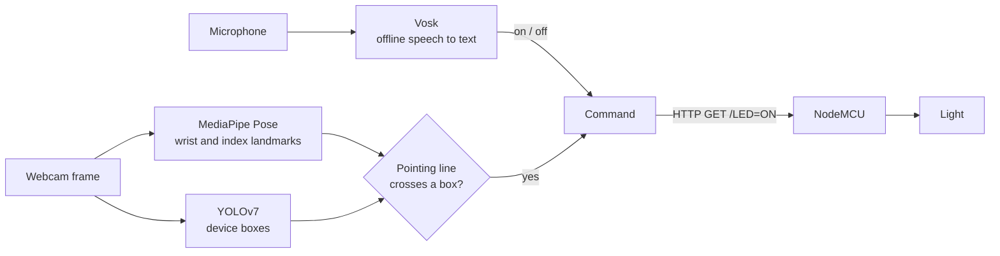

<p align="center">
  
  
  
  
</p>

**Smart Home Interactions** lets you control a device the way you would ask a person to: point at it and say "on".

A webcam watches the room. YOLOv7 finds the devices, MediaPipe tracks your arms, and an offline speech recogniser listens for the command. When your hand lines up with a device and you say the word, a NodeMCU switches it.

## How it works



1. **See the devices.** `detect.py` runs YOLOv7 on every frame and draws a box around each device it knows.
2. **See the person.** MediaPipe Pose runs on the same frame, inside the frame loader in `utils/datasets.py`. It keeps the wrist and index-finger landmarks of both hands.
3. **Decide what is being pointed at.** A line is cast from each hand and tested against every device box with a line-rectangle intersection check. A hit marks that device as the one being pointed at.
4. **Listen.** `voice.py` runs alongside. It streams the microphone through Vosk and writes the latest phrase to `words.txt`.
5. **Act.** If a device is being pointed at and the latest phrase contains "on" or "off", the script sends an HTTP request to the NodeMCU that switches it.

Speech recognition is fully offline, and the only network traffic is the request to the microcontroller on your own Wi-Fi.

## Run it

A virtual environment is a good idea.

```bash
git clone https://github.com/codex-exe/yolov7-mediapipe.git
cd yolov7-mediapipe
pip install -r requirements.txt
pip install mediapipe vosk sounddevice scikit-learn
```

You need two things that are not in the repo:

- **YOLOv7 weights** trained on the devices you want to control. The script looks for `best.pt` by default.
- **A NodeMCU (or any ESP8266)** that serves `/LED=ON` and `/LED=OFF`. Put its address in `detect.py`.

Then start the listener and the detector in two terminals:

```bash
python voice.py
```

```bash
python detect.py --source 0 --weights best.pt --view-img
```

Point at the device and say "on".

If you hit version conflicts, check the current install notes for [Vosk](https://github.com/alphacep/vosk-api), [MediaPipe](https://github.com/google/mediapipe) and [YOLOv7](https://github.com/WongKinYiu/yolov7).

## Where the interesting code is

| File | What it does |
| :--- | :--- |
| `detect.py` | Detection loop, line-rectangle intersection, and the HTTP calls |
| `utils/datasets.py` | `LoadStreams` runs MediaPipe Pose on each webcam frame and returns hand landmarks with the image |
| `voice.py` | Microphone stream into Vosk, latest phrase into `words.txt` |

Everything else is the upstream YOLOv7 codebase.

## Credits

Built on [YOLOv7](https://github.com/WongKinYiu/yolov7) by Wang, Bochkovskiy and Liao, which is GPL-3.0 licensed, so this repository is too. Pose tracking is [MediaPipe](https://github.com/google/mediapipe) and speech recognition is [Vosk](https://github.com/alphacep/vosk-api).
